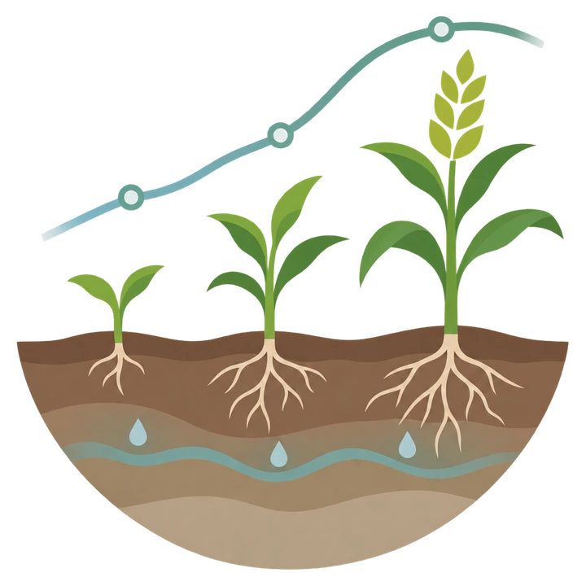
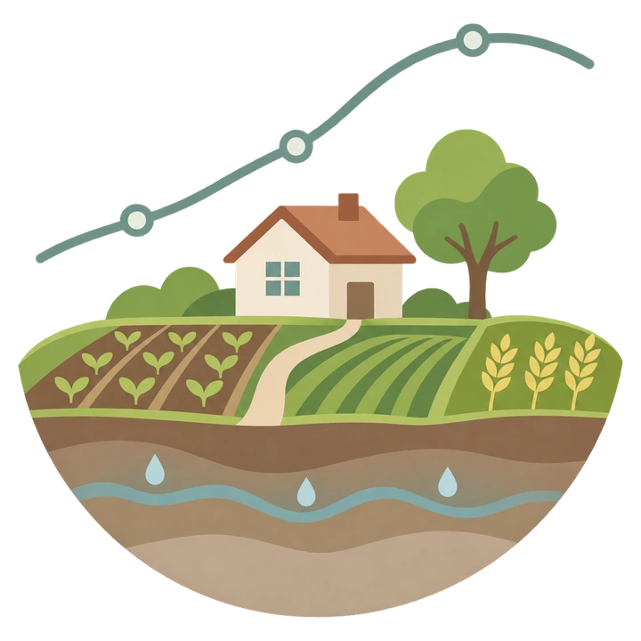
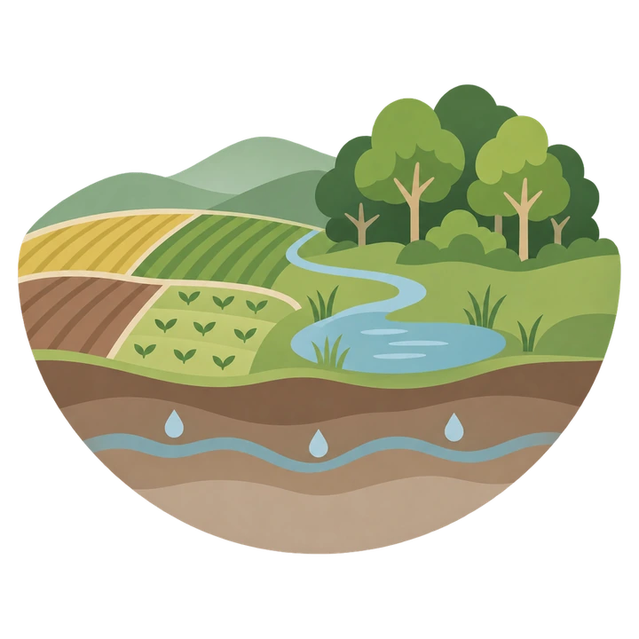
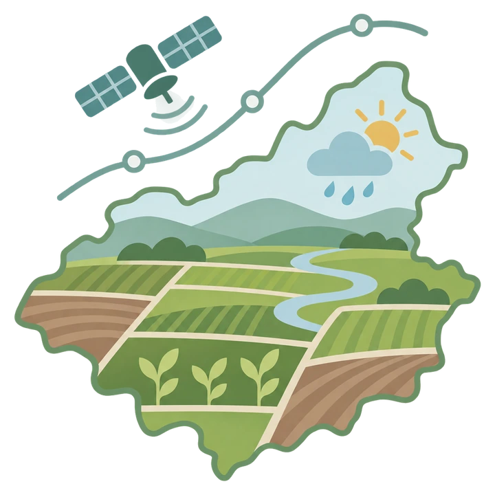
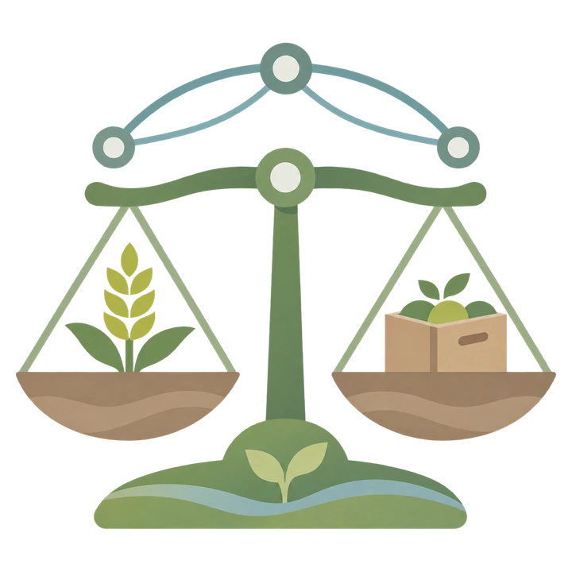

```{=html}
<section class="bb-hero" aria-label="Introduction">
  <div class="bb-hero-left">
    <div class="bb-eyebrow">Leibniz Centre for Agricultural Landscape Research</div>
    <h1 class="bb-name">Multi-Scale<br><span class="ln2">Modelling.</span></h1>
    <p class="bb-role">A working group of Research Area 4 <a href="https://www.zalf.de/en/struktur/pb4/Pages/default.aspx">Simulation and Data Science</a><span class="at">, at ZALF.</span></p>
    <p class="bb-intro">We model farm systems across scales — fields, farms, landscapes, regions and markets — and combine process-based models with data-driven AI to forecast and evaluate the effects of climate, market and policy change on cropping systems.</p>
    <div class="msm-cta">
      <a class="msm-btn" href="research.html">Our research</a>
      <a class="msm-btn ghost" href="publications.html">Publications</a>
      <a class="msm-btn ghost" href="jobs.html">Join us</a>
    </div>
  </div>
  <div class="bb-hero-right">
    <ol class="msm-stairs" aria-label="Scales modelled by MSM, from field to market">
        <li class="msm-step msm-step--field">
          <picture class="msm-step-icon">
            <source srcset="assets/scales/scale-field.avif" type="image/avif">
            
          </picture>
          <span class="msm-step-name">Field</span>
        </li>
        <li class="msm-step msm-step--farm">
          <picture class="msm-step-icon">
            <source srcset="assets/scales/scale-farm.avif" type="image/avif">
            
          </picture>
          <span class="msm-step-name">Farm</span>
        </li>
        <li class="msm-step msm-step--landscape">
          <picture class="msm-step-icon">
            <source srcset="assets/scales/scale-landscape.avif" type="image/avif">
            
          </picture>
          <span class="msm-step-name">Landscape</span>
        </li>
        <li class="msm-step msm-step--region">
          <picture class="msm-step-icon">
            <source srcset="assets/scales/scale-region.avif" type="image/avif">
            
          </picture>
          <span class="msm-step-name">Region</span>
        </li>
        <li class="msm-step msm-step--market">
          <picture class="msm-step-icon">
            <source srcset="assets/scales/scale-market.avif" type="image/avif">
            
          </picture>
          <span class="msm-step-name">Market</span>
        </li>
    </ol>
    <svg class="bb-squiggle" viewBox="0 0 240 130" width="240" height="130" fill="none" aria-hidden="true">
      <path d="M6 96 C 40 120, 70 60, 110 70 S 180 110, 224 40" stroke="currentColor" stroke-width="2.4" stroke-linecap="round" stroke-dasharray="2 11"/>
      <path d="M224 40 l -14 2 m 14 -2 l -4 -13" stroke="currentColor" stroke-width="2.4" stroke-linecap="round"/>
    </svg>
  </div>
</section>
```

:::: {.page-section}

```{=html}
<div class="section-head">
  <h2 id="research">Research focus</h2>
  <a class="section-more" href="research.html">All research themes</a>
</div>
```

::: {#Themes}
:::

::::

:::: {.page-section .section-tint}

```{=html}
<div class="section-head">
  <h2 id="projects">Current projects</h2>
  <a class="section-more" href="projects.html">All projects</a>
</div>
```

::: {#Projects}
:::

::::

:::: {.page-section .publications-section}

```{=html}
<div class="section-head">
  <h2 id="publications">Recent publications</h2>
  <a class="section-more" href="publications.html">All publications</a>
</div>
```

::: {#Recent-publications}
:::

::::

:::: {.page-section .section-tint}

```{=html}
<div class="section-head">
  <h2 id="tools">Tools</h2>
  <a class="section-more" href="tools.html">All tools</a>
</div>
```

::: {#Tools}
:::

::::

:::: {.page-section .section-tint}

```{=html}
<div class="section-head">
  <h2 id="posts">Posts</h2>
  <a class="section-more" href="posts.html">All posts</a>
</div>
```

::: {#Posts}
:::

::::

:::: {.page-section}

```{=html}
<div class="msm-band">
  <div>
    <h2>Work with us</h2>
    <p>We welcome students and researchers interested in crop and farm-system modelling, hybrid AI–process modelling and Earth observation for agriculture.</p>
  </div>
  <a class="msm-btn" href="jobs.html">Jobs &amp; opportunities</a>
</div>
```

::::
